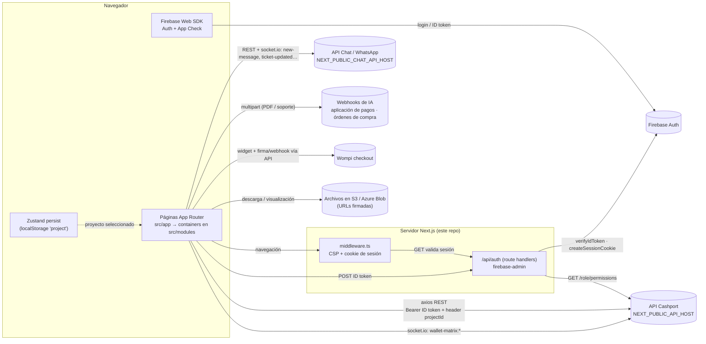

# Cashport — Frontend web

Cashport es la solución **Order-to-Cash (O2C)** de Profitline. Cubre la recepción de pedidos, la facturación, la cartera, la cobranza, los pagos y su aplicación. Cada cliente usa solo los módulos que tiene contratados.

Este repositorio es **solo el frontend web** (Next.js). Lo que hay aquí:

- Las pantallas de los módulos.
- La autenticación con Firebase y la sesión.
- Las llamadas a las APIs de Cashport.

La lógica de negocio, los cálculos y los procesos programados viven en los servicios backend. Este repo los consume por HTTP y WebSocket.

> El conocimiento de negocio (módulos, reglas, glosario, actores) está en **Cashport Brain** (biblioteca `cashport-docs` en SharePoint). Este README describe solo lo técnico que se ve en el código.

---

## Stack

Versiones tomadas de `package.json`:

| Área               | Tecnología                                                                                                                   |
| ------------------ | ---------------------------------------------------------------------------------------------------------------------------- |
| Framework          | Next.js `14.2.31` (App Router), React `^18`, TypeScript `^5`                                                                 |
| UI                 | Ant Design `5.18.3`, Tailwind CSS `^3.4.0` (+ `class-variance-authority`, `tailwind-merge`), Radix UI, SCSS (`sass ^1.70.0`) |
| Estado             | Zustand `^4.5.0` (con `persist`), React Context                                                                              |
| Datos del servidor | SWR `^2.2.4`, react-query `^3.39.3`, axios `^1.6.7`                                                                          |
| Formularios        | react-hook-form `^7.49.3`, Yup `^1.3.3`, Zod `3.25.67`                                                                       |
| Autenticación      | Firebase `^10.8.0` (cliente), firebase-admin `^12.0.0` (route handlers)                                                      |
| Tiempo real        | socket.io-client `^4.8.1`                                                                                                    |
| Gráficas y mapas   | recharts, apexcharts / react-apexcharts, lightweight-charts, maplibre-gl                                                     |
| Documentos         | @react-pdf-viewer, pdfjs-dist `3.4.120`, draft-js, react-markdown                                                            |
| Íconos             | lucide-react, phosphor-react / @phosphor-icons/react                                                                         |
| Calidad            | ESLint `^8.56.0` (`eslint-config-next`, prettier), Prettier `^3.2.4`, Husky, lint-staged, commitlint + commitizen            |

Gestor de paquetes: **Yarn 1.22.22** (`packageManager` en `package.json`). El repo trae también un `package-lock.json`, pero el lockfile de referencia es `yarn.lock`.

---

## Levantar el proyecto en local

### Requisitos

- **Node.js ≥ 18.17.** Lo exige Next 14.2; el `dockerfile` usa `node:18-alpine`.
- **Yarn 1.x.**
- Un archivo `.env` con las variables de la siguiente tabla. Pide los valores al equipo: nunca se versionan (`.env*` está en `.gitignore`).

### Variables de entorno

| Variable                                                                                                                                                                                                                                                       | Para qué sirve                                                                                                                            | Dónde se usa                                                                                                  |
| -------------------------------------------------------------------------------------------------------------------------------------------------------------------------------------------------------------------------------------------------------------- | ----------------------------------------------------------------------------------------------------------------------------------------- | ------------------------------------------------------------------------------------------------------------- |
| `NEXT_PUBLIC_API_HOST`                                                                                                                                                                                                                                         | URL base del API REST principal de Cashport. Termina en `/api`: el socket de la matriz de cartera y el CSP le quitan ese sufijo           | `src/config/index.ts`, `src/utils/api/api.ts`, `src/middleware.ts`, `src/utils/permissions/getPermissions.ts` |
| `NEXT_PUBLIC_CHAT_API_HOST`                                                                                                                                                                                                                                    | URL base del API de chat/WhatsApp (REST + socket.io)                                                                                      | `src/services/chat/chat.ts`, `src/context/ChatContext.tsx`                                                    |
| `NEXT_PUBLIC_API_APPLY_TAB_AI`                                                                                                                                                                                                                                 | Webhook de IA que lee el soporte de pago en la mesa de aplicación                                                                         | `src/services/applyTabClients/applyTabClients.ts`                                                             |
| `NEXT_PUBLIC_API_APPLY_TAB_AI_DEMO`                                                                                                                                                                                                                            | El mismo webhook para el proyecto/cliente demo                                                                                            | `src/services/applyTabClients/applyTabClients.ts`                                                             |
| `NEXT_PUBLIC_API_PURCHASE_ORDERS_AI`                                                                                                                                                                                                                           | Webhook de IA que interpreta el PDF de una orden de compra                                                                                | `src/services/purchaseOrders/purchaseOrders.ts`                                                               |
| `NEXT_PUBLIC_API_WOMPI_PUBLIC_KEY`                                                                                                                                                                                                                             | Llave pública del widget de checkout de Wompi                                                                                             | `src/components/organisms/paymentWeb/PaymentWebView.tsx`                                                      |
| `NEXT_PUBLIC_COOKIE_SESSION_NAME`                                                                                                                                                                                                                              | Nombre de la cookie de sesión                                                                                                             | `src/middleware.ts`, `src/app/api/auth/route.ts`                                                              |
| `NEXT_PUBLIC_FIREBASE_API_KEY`, `NEXT_PUBLIC_FIREBASE_AUTH_DOMAIN`, `NEXT_PUBLIC_FIREBASE_PROJECT_ID`, `NEXT_PUBLIC_FIREBASE_STORAGE_BUCKET`, `NEXT_PUBLIC_FIREBASE_MESSAGING_SENDER_ID`, `NEXT_PUBLIC_FIREBASE_APP_ID`, `NEXT_PUBLIC_FIREBASE_MEASUREMENT_ID` | Configuración del SDK web de Firebase                                                                                                     | `firebase.ts`                                                                                                 |
| `NEXT_PUBLIC_FIREBASE_ADMIN_PROJECT_ID`, `NEXT_PUBLIC_FIREBASE_ADMIN_CLIENT_EMAIL`, `NEXT_PUBLIC_FIREBASE_ADMIN_PRIVATE_KEY`                                                                                                                                   | Credenciales de servicio de firebase-admin. Las usan los route handlers de `/api/auth` para verificar tokens y emitir la cookie de sesión | `firebase-admin-config.ts`                                                                                    |
| `NEXT_DIST_DIR`                                                                                                                                                                                                                                                | Opcional. Carpeta de salida del build; la fija `yarn build:check`                                                                         | `next.config.js`                                                                                              |

> ⚠️ `.env.template` está desactualizado: lista las variables de Firebase **sin** el prefijo `NEXT_PUBLIC_` y le faltan las demás. Usa esta tabla como referencia.

### Comandos

```bash
yarn install          # instala dependencias (también instala los hooks de Husky)
yarn dev              # servidor de desarrollo en http://localhost:3000
yarn build            # build de producción en .next/
yarn build:check      # build de verificación en .next-build/ (no pisa el .next/ de un `yarn dev` en curso)
yarn start            # sirve el build de producción
yarn clean            # borra .next/ y .next-build/
yarn lint             # ESLint (next lint)
yarn lint:fix
yarn prettier         # formatea todo el repo
yarn prettier:check
yarn commit           # commit convencional asistido (git-cz)
```

Abre [http://localhost:3000](http://localhost:3000).

- Sin sesión, el middleware redirige a `/auth/login`.
- Con sesión, `/` redirige a `/clientes/all`.

### Docker

El `dockerfile` instala con Yarn, ejecuta `yarn build` y sirve con `yarn start` en el puerto 3000. Las variables `NEXT_PUBLIC_*` se incrustan en el build, así que deben estar disponibles al construir la imagen.

---

## Pruebas

**No hay pruebas automatizadas**: no existe test runner configurado ni archivos `*.test.*` / `*.spec.*`.

La verificación disponible es estática:

```bash
npx tsc --noEmit      # tipos
yarn lint             # ESLint
yarn build:check      # build completo sin tocar .next/
```

La UI se valida a mano en el navegador con una sesión real, porque las rutas están protegidas por Firebase.

---

## Estructura del repositorio

```
.
├── firebase.ts                 SDK web de Firebase (Auth, App Check, decodificación de claims)
├── firebase-admin-config.ts    Inicialización de firebase-admin (server)
├── firebase-utils.ts           Flujo de login/logout y emisión de la cookie de sesión
├── next.config.js              distDir configurable, imágenes sin optimizar, alias de webpack
├── tailwind.config.js          Tokens de diseño (CSS variables)
├── dockerfile
├── public/                     fuentes, imágenes, gifs
└── src/
    ├── middleware.ts           CSP + protección de rutas por cookie de sesión
    ├── app/                    Rutas (App Router). Las páginas son delgadas y renderizan un container
    │   └── api/auth/           Route handlers: login (POST), validación de sesión (GET), logout
    ├── modules/                Módulos funcionales (components/ + containers/ + hooks/ …)
    ├── components/             Librería compartida: atoms/, molecules/, organisms/, ui/
    ├── services/               Funciones de API por dominio (llaman a API.get/post/…)
    ├── hooks/                  Hooks de datos (SWR / react-query) sobre los servicios
    ├── types/                  Tipos de respuesta del API por dominio
    ├── lib/                    Store de Zustand (store/, slices/, hook/)
    ├── context/                Contexts: chat (socket), matriz de cartera (socket), modales, mensajes, notificaciones…
    ├── config/                 Mapea variables de entorno a `config.API_*`
    ├── utils/                  Cliente axios (api/), permisos de rutas (permissions/), constantes, archivos
    ├── constants/              Tipos de aprobación, tipos de documento
    ├── theme/                  Tema global de Ant Design
    ├── styles/                 globals.scss, tailwind.css, _variables.scss
    └── interfaces/             Interfaces sueltas (legado)
```

Las convenciones de código (estilos, nombres, cómo partir componentes) están en `CLAUDE.md`.

---

## Módulos funcionales

Rutas tomadas de `src/app/**/page.tsx`. El nombre de permiso es el `page_name` que decide si el botón aparece en el menú (ver [Permisos y modularidad](#permisos-y-modularidad)).

| Módulo (Cashport Brain)  | Rutas                                                                                                                                                                                      | Código principal                                                                                        | Permiso de menú                             |
| ------------------------ | ------------------------------------------------------------------------------------------------------------------------------------------------------------------------------------------ | ------------------------------------------------------------------------------------------------------- | ------------------------------------------- |
| Cartera                  | `/clientes/all`, `/clientes/detail/[clientId]/project/[projectId]/{cartera,dashboard,pagos,historial,contactos,notas}`, `/wallet` (matriz de control), `/dashboard`                        | `src/components/organisms/Customers/`, `src/modules/clients/`, `src/modules/walletModule/`              | `Clientes`, `Wallet`, `Dashboard`           |
| Conciliación             | `/conciliacion/[clientId]`                                                                                                                                                                 | `src/components/organisms/projects/MassConcilationView/`                                                | —                                           |
| Novedades                | `/novelties`                                                                                                                                                                               | `src/modules/noveltiesModule/`, `src/modules/walletModule/components/group-detail-modal/`               | `Novelties`                                 |
| Saldos                   | `/balances`, `/clientes/detail/.../saldos`                                                                                                                                                 | `src/modules/balances/`, `src/modules/clients/containers/balances-tab/`                                 | `Balances`                                  |
| Pagos y aplicación       | `/clientes/detail/.../aplicacion`, `/applyModule` (demo), pestañas de aplicaciones en `/banco`                                                                                             | `src/modules/clients/containers/apply-tab/`, `src/modules/banks/`                                       | `Bancos`                                    |
| Bancos                   | `/banco` (pagos, reglas de identificación, legalizaciones)                                                                                                                                 | `src/modules/banks/`                                                                                    | `Bancos`                                    |
| Órdenes de compra        | `/purchase-orders`, `/purchase-orders/[orderId]`, `/purchase-orders/create`, `/purchase-orders/dashboard`                                                                                  | `src/modules/purchaseOrders/`                                                                           | `PurchaseOrders`                            |
| Marketplace              | `/comercio`, `/comercio/pedido`, `/comercio/pedidoConfirmado/[orderId]`, `/comercio/dashboard`, `/comercio/cetaphil`; administración en `/market-admin/**`; descuentos en `/descuentos/**` | `src/modules/commerce/`, `src/modules/marketAdmin/`, `src/components/organisms/discounts/`              | `Marketplace`, `MarketAdmin`                |
| Facturación              | No tiene módulo propio. Los pasos de facturación están dentro de órdenes de compra (enviar a facturar, cargar factura, refacturar, TXT para ERP) y de cuentas médicas                      | `src/modules/purchaseOrders/`                                                                           | —                                           |
| Cobranza y WhatsApp      | `/chat` (bandeja de WhatsApp), `/mass-communications/**`, `/mobile/**` (portal móvil del cliente con links de pago)                                                                        | `src/modules/chat/`, `src/modules/massCommunications/`, `src/modules/cashportMobile/`                   | `Whatsapp`, `MassCommunications`            |
| Tickets, chat y logs     | `/tickets`, `/task-manager` (y el legado `/gestor-tareas`), `/notificaciones`, historial en `/clientes/detail/.../historial`                                                               | `src/modules/ticketsModule/`, `src/modules/taskManager/`, `src/modules/clients/containers/history-tab/` | `Tickets`, `GestorTareas`, `Notificaciones` |
| Logística y devoluciones | `/logistica-inversa/{devoluciones,aprobaciones,aprobaciones/[id]}`                                                                                                                         | `src/modules/reverseLogistics/`                                                                         | `ReverseLogistics`                          |
| ETL / CTL                | Solo la UI de "Profit Loader" en `/market-admin/load`: lista cargadores, timeline y carga de archivos. Crear un ETL aún no está disponible. No hay nada de CTL                             | `src/modules/marketAdmin/`                                                                              | `MarketAdmin`                               |

Módulos presentes en el código que Cashport Brain todavía no describe:

| Módulo                                                          | Rutas                                       | Código                                              | Permiso                                     |
| --------------------------------------------------------------- | ------------------------------------------- | --------------------------------------------------- | ------------------------------------------- |
| Calidad de datos (ingesta por cliente/país, catálogos, alertas) | `/data-quality/**`                          | `src/modules/dataQuality/`                          | `DataQuality` (más permisos por componente) |
| Cuentas médicas                                                 | `/cuentas-medicas`, `/cuentas-medicas/[id]` | `src/modules/medicalAccounts/`                      | `MedicalAccounts`                           |
| Aprobaciones (flujos de aprobación por pasos)                   | `/aprobaciones`                             | `src/modules/aprobaciones/`                         | `Aprobaciones`                              |
| Proveedores / terceros                                          | `/proveedores`, `/proveedores/[id]`         | `src/components/organisms/proveedores/`             | `Proveedores` (oculto en el menú)           |
| Proyectos y configuración                                       | `/settings`, `/proyectos/**`                | `src/components/organisms/projects/`                | `Configuracion`                             |
| Portal Cetaphil (marketplace para invitados)                    | `/cetaphil` (pública)                       | `src/modules/cetaphil/`                             | —                                           |
| Portal de archivos (descarga por token)                         | `/portal-archivos` (pública)                | `src/app/portal-archivos/`                          | —                                           |
| Torre de control                                                | `/torreControl`                             | `src/modules/torreControlModule/` (datos simulados) | oculto en el menú                           |
| Nuevo dashboard                                                 | `/newDashboard`                             | `src/modules/new_dashboard/` (datos simulados)      | oculto en el menú                           |
| Informes (informes HTML publicados para el equipo)              | `/reports`, `/reports/[id]`                 | `src/modules/reportsModule/` (datos simulados)      | `Reports`                                   |

---

## Arquitectura

Diagrama respaldado por el código del repo. No muestra lo que pasa dentro de los backends.



### Autenticación y sesión

1. El usuario inicia sesión con Firebase en el cliente (`firebase-utils.ts`). El ID token se envía a `POST /api/auth`.
2. El route handler hace lo siguiente:
   - Verifica el token con firebase-admin.
   - Consulta `GET {API_HOST}/role/permissions`.
   - Comprime los permisos (zlib + base64) en un custom token.
   - Fija una cookie de sesión `httpOnly` de 14 días (`src/app/api/auth/route.ts`).
3. `src/middleware.ts` corre en cada navegación:
   - Arma la cabecera CSP.
   - Deja pasar sin sesión las rutas públicas (`/auth`, `/mobile`, `/cetaphil`, `/portal-archivos`).
   - En el resto, valida la cookie contra `GET /api/auth`.

### Llamadas al API

- `src/utils/api/api.ts` define dos instancias de axios:
  - `API`: interceptores de token y errores (`ApiError`).
  - `instance` / `fetcher`: la que usa SWR.
- Ambas envían `Authorization: Bearer <Firebase ID token>` y la cabecera **`projectId`** con el proyecto seleccionado (`setProjectInApi`, que se llama desde `createProjectSlice`).
- Los servicios (`src/services/<dominio>/`) exponen funciones async. Los hooks (`src/hooks/`, `src/modules/*/hooks/`) las envuelven con SWR o react-query.

### Permisos y modularidad

Cada proyecto (cliente) tiene permisos por rol: `views_permissions[].page_name` y `components[]`, más `is_super_admin`.

- El menú (`src/components/atoms/NavigationBar/ModulesButtons/ModulesButtons.tsx`) muestra cada módulo con `checkUserViewPermissions`.
- `src/utils/permissions/routePermissions.ts` protege por URL solo las rutas de `ROUTE_PREFIX_TO_PERMISSION`. Las rutas que no están en ese mapa no exigen permiso.
- Hay comportamiento específico por cliente, controlado por IDs de proyecto en `src/utils/constants/globalConstants.ts` y algunos literales en el código.

---

## Procesos programados, tiempo real e integraciones

Este repo **no ejecuta jobs, crons ni ETL**. Lo que el código muestra:

**Procesos del backend que el frontend observa**

- **Matriz de cartera** (`/wallet`):
  - Los snapshots se generan en el backend (`trigger: "CRON" | "MANUAL"` en `src/types/portfolios/IWalletMatrix.ts`).
  - El front pide la regeneración con `POST /portfolio/matrix/refresh` y escucha `wallet-matrix:started|done|failed` por socket.io (`src/context/WalletMatrixSocketContext.tsx`).
  - Mientras la regeneración está en curso, consulta el estado cada 5 s (`src/hooks/useWalletMatrix.ts`).
- **Profit Loader (ETL)**: carga de archivos y timeline de ejecuciones en `/market-admin/load` (`/profit-loader/*`). La ejecución ocurre en el backend.
- **Calidad de datos**: parametrización de ingesta, periodicidad, reglas de enrutamiento de correo y contexto de IA por cliente (`/data/*`).

**Polling desde el navegador**

| Archivo                             | Frecuencia                         | Qué consulta                   |
| ----------------------------------- | ---------------------------------- | ------------------------------ |
| `src/hooks/useChatTickets.ts`       | 7 s                                | Tickets de WhatsApp            |
| `src/context/CountNotification.tsx` | 10 min                             | Contador de notificaciones     |
| `src/hooks/useWalletMatrix.ts`      | 5 s, solo durante una regeneración | Estado de la matriz de cartera |

**Integraciones externas visibles desde el front**

| Integración                | Cómo se usa                                                                                               | Dónde                                                                                          |
| -------------------------- | --------------------------------------------------------------------------------------------------------- | ---------------------------------------------------------------------------------------------- |
| API Cashport               | REST + socket.io                                                                                          | `src/services/**`, `src/utils/api/api.ts`                                                      |
| API de chat / WhatsApp     | REST (`/whatsapp-tickets`, `/whatsapp-messages`, `/whatsapp-templates`) + socket.io                       | `src/services/chat/`, `src/context/ChatContext.tsx`                                            |
| IA para soportes de pago   | POST multipart a `NEXT_PUBLIC_API_APPLY_TAB_AI(_DEMO)`. El CSP nombra estos hosts como n8n                | `src/services/applyTabClients/applyTabClients.ts`                                              |
| IA para órdenes de compra  | POST multipart a `NEXT_PUBLIC_API_PURCHASE_ORDERS_AI`, o `/purchaseOrder/upload-to-n8n` según el proyecto | `src/services/purchaseOrders/purchaseOrders.ts`                                                |
| Wompi                      | Widget `checkout.wompi.co`. La firma y el webhook pasan por el API (`marketplace/wompi/*`)                | `src/components/organisms/paymentWeb/PaymentWebView.tsx`, `src/services/paymentWeb/payment.ts` |
| Firebase                   | Auth, App Check, firebase-admin                                                                           | `firebase.ts`, `firebase-admin-config.ts`                                                      |
| Almacenamiento de archivos | Descarga y visualización de URLs en `*.amazonaws.com` y `*.blob.core.windows.net` (permitidos en el CSP)  | `src/middleware.ts`                                                                            |
| Servicio de correo         | `POST /api/comunication/email` a un host **escrito a mano** en el código, no en la configuración          | `src/services/sendEmail/sendEmail.ts`                                                          |
| Logística inversa          | Todo pasa por el API en `/integration/profit360/*`                                                        | `src/services/reverseLogistics/`                                                               |
| Mapas                      | Tiles de CartoDB con maplibre-gl, solo en `/newDashboard`                                                 | `src/modules/new_dashboard/components/DashboardMap.tsx`                                        |

---

## Relación con otros servicios

Este frontend depende de dos backends que viven en otros repositorios: el **API de Cashport** y el **API de chat/WhatsApp**. También depende de los **webhooks de IA**.

No hay un BFF propio: los únicos route handlers de Next son `/api/auth` y `/api/auth/logout`. Todo lo demás se llama directo desde el navegador.

Los modelos de datos, las migraciones, los jobs y los ETL no están en este repo.
